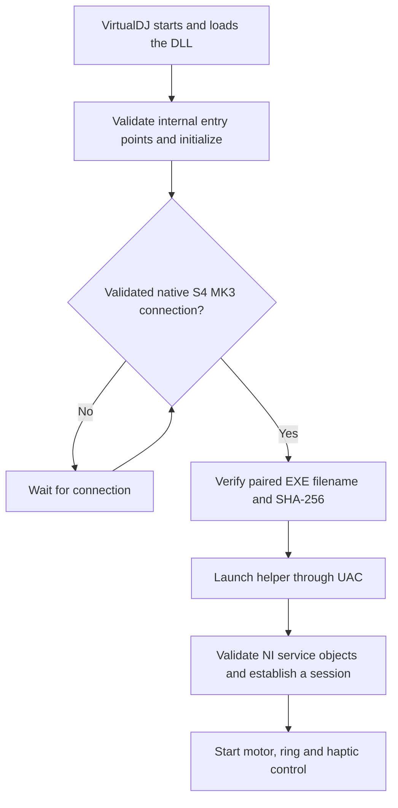
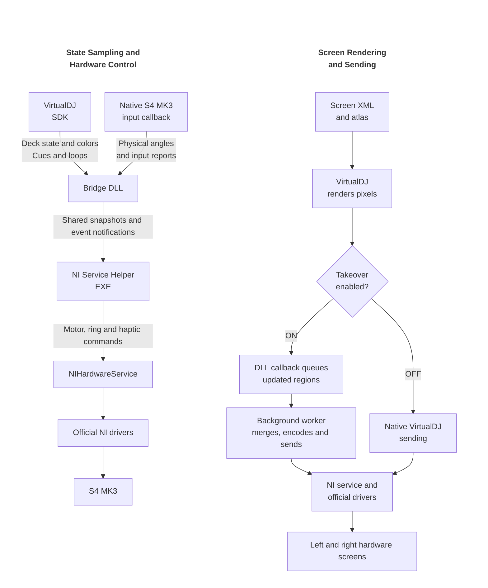

# Development

[中文](DEVELOPMENT_zh.md) · English

## Design Approach

The main reasons for this approach are to **avoid replacing device drivers** and to reuse **VirtualDJ's screen support for Traktor devices such as the S5 and S8**. Screen content is designed using VirtualDJ skin XML, then rendered and output by VirtualDJ, rather than implementing a separate screen renderer in an external application.

Device control uses **NIHardwareService and the official NI drivers**, allowing Traktor Pro 3/4 to be used directly after VirtualDJ closes. The DLL obtains playback state and device input inside VirtualDJ, while the paired EXE handles NI service access requiring administrator privileges, without elevating VirtualDJ itself.

Optional output takeover reduces main-interface stutter caused by screen transport. VirtualDJ still renders the frames, but a **DLL background thread** sends them. Disabling takeover restores native VirtualDJ sending.

## Build Methods

### Visual Studio

Open [Traktor Kontrol S4 MK3.slnx](../../Source/Traktor%20Kontrol%20S4%20MK3.slnx) in Visual Studio with Desktop development with C++ and a Windows SDK installed. The solution contains Bridge (DLL) and NI Service Helper (EXE), both x64. Choose Release | x64 and Build Solution. Debug | x64 is also available. C++17, UTF-8 and static CRT are configured centrally; VS 2022 uses v143 and VS 2026 uses v145 when no toolset override is supplied.

Output: `Source/artifacts/x64/Release/`. Both runtime files are placed together. Building neither installs files nor starts VirtualDJ/the helper. Do not treat the DLL project as a normal executable for F5 launch.

Bridge references NI Service Helper: MSBuild finishes the EXE first, generates its SHA-256 header, then builds the DLL. The two `.vcxproj` files contain the version (v0.1.0), compiler options, output paths and inline MSBuild C# tasks that generate release_identity.h, release_digest.h and the DLL export definition. No Python or external build script is required. Generated files only change when their content changes, preserving incremental builds.

### Command Line

From the repository root, run this in Visual Studio **Developer PowerShell** or the **x64 Native Tools Command Prompt**:

```powershell
msbuild "Source/Traktor Kontrol S4 MK3.slnx" /m /t:Build /p:Configuration=Release /p:Platform=x64
```

To change the version, set `S4Version` in both `.vcxproj` files or pass `/p:S4Version=v0.1.0`. Use `vMAJOR.MINOR.PATCH` and the same value for both projects. Rebuild Bridge after the EXE changes to update the digest binding.

## Source Layout

| File / directory | Responsibility |
| --- | --- |
| `Traktor Kontrol S4 MK3 Bridge.cpp` | Plugin entry, state collection and publishing, helper lifetime and screen coordination |
| `Traktor Kontrol S4 MK3 NI Service Helper.cpp` | Helper entry, connection and session retries |
| `include/bridge_ipc.h` | Shared snapshots, identity, generations and event notifications |
| `include/deck_sampler.h` | Deck-bound SDK sampling |
| `include/startup_input.h` | Report 1/2 initial-state synchronization and passive physical-angle sampling from Report 3 |
| `include/jog_ring.h` | Colors, targets and hybrid ring phase |
| `include/haptic_cue.h` | Cue/loop timeline and NI haptic output |
| `include/ni_service_session.h` | NI session, motor policy, serialized commands and independent watchdog |
| `include/screen_takeover.h` | Native pixel hook, merging queue and asynchronous sending |
| `include/vdj_compatibility.h` / `ni_service_compatibility.h` | Validated known locations, signatures and parsed fields |
| `include/signatures/` | VDJ / NI instruction signatures |
| `include/helper_launcher.h` | Paired EXE digest verification, elevated launch and module lifetime management |
| `include/runtime_utils.h` | QPC scheduling, diagnostics and retry tools |

## Runtime Principles

### Startup and Connection



### State Sampling, Hardware Control and Screen Output



| Stage | Behavior |
| --- | --- |
| Sampling | The DLL targets 10ms / 100Hz SDK sampling; physical angles come from the native input callback without additional USB reads. |
| Interprocess transfer | Shared snapshots carry sequence numbers, session identity, connection generation and timestamps. Events wake consumers when data changes. |
| Hardware output | The EXE uses the existing NI pipe and validated service caches. Ordinary commands are serialized, with motor commands prioritized. |
| Ring phase | With TT off, Physical Jog combines playback phase and manual movement; touch, pause and CUE preview hold automatic phase. With TT on, it follows physical angles directly. Absolute Position follows the software pointer position. |

Takeover changes the pixel transport path; VirtualDJ still renders the content. The background queue retains the latest image and merges updates. Approximately 60Hz per side is a software scheduling target.

### Failure and Shutdown Guards

| Condition | Response |
| --- | --- |
| Internal entry point or object validation fails | Disable affected custom features and display a warning; do not write to unverified locations. |
| Stale data, lost connection or session identity mismatch | Consumers reject invalid data and enter the corresponding stop or wait path. |
| Helper or host exit, or heartbeat failure | An independent watchdog cleans up motors, rings and haptics and checks readback. |

<a id="runtime-logs"></a>

## Runtime Logs

Logs are saved automatically in `Plugins64\AutoStart` inside the VirtualDJ data folder:

| Log file | Main contents |
| --- | --- |
| `Traktor-Kontrol-S4-MK3-Bridge-v0.1.0.log` | DLL loading, VirtualDJ compatibility checks, device connection, helper launch and screen output |
| `Traktor-Kontrol-S4-MK3-NI-Service-Helper-v0.1.0.log` | NI service connection, motor, ring and haptic control, and cleanup results after abnormal termination |

When a log exceeds 10 MB, the previous session’s contents are automatically cleared. Please attach the logs when reporting a problem.
