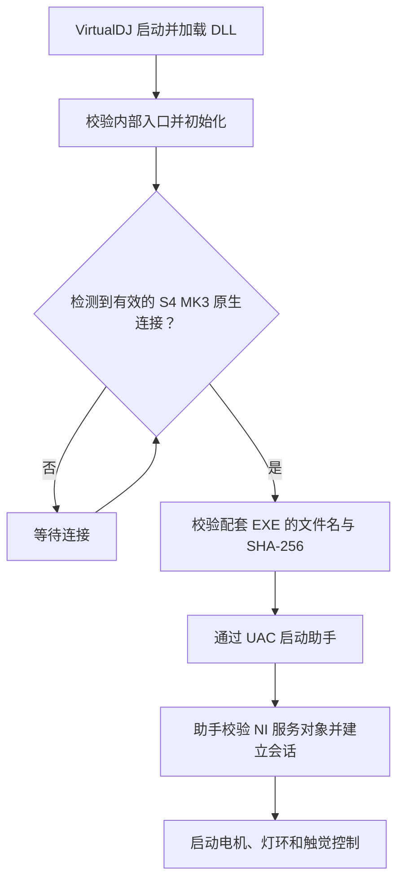
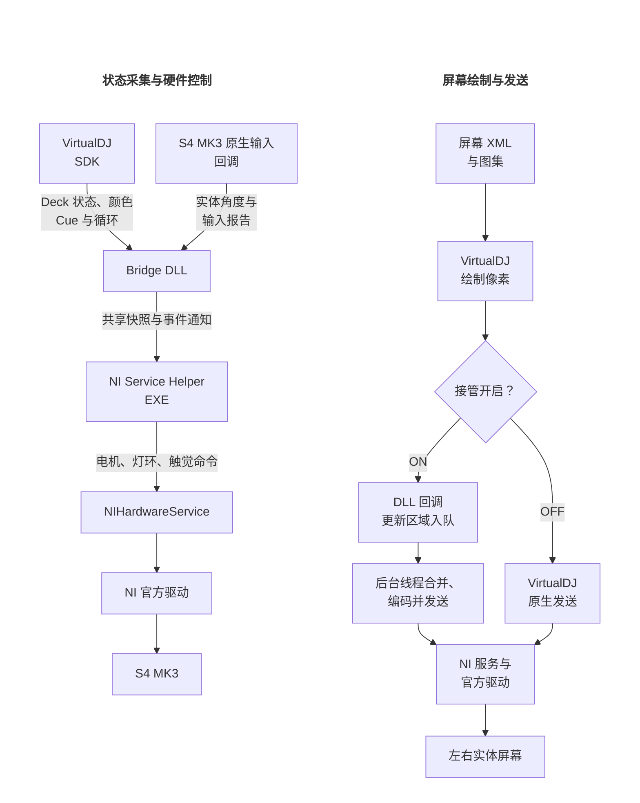

# 开发相关

中文 · [English](DEVELOPMENT.md)

## 设计思路

选择这套方案，主要是为了**无需替换设备驱动**，并复用 **VirtualDJ 对 Traktor S5、S8 等设备的屏幕支持**，通过 VirtualDJ 的皮肤 XML 设计屏幕内容，由 VirtualDJ 绘制并输出画面，而不是在外部程序中重新实现一套屏幕渲染。

设备控制沿用 **NIHardwareService 和 NI 官方驱动**，因此关闭 VirtualDJ 后可以直接使用 Traktor Pro 3/4。DLL 在 VirtualDJ 内获取播放状态和设备输入，配套 EXE 负责需要管理员权限的 NI 服务访问，无需让 VirtualDJ 本身提权。

为减少屏幕传输造成的主界面卡顿，提供可选的输出接管：画面仍由 VirtualDJ 绘制，改由 **DLL 后台线程**发送；关闭接管后恢复 VirtualDJ 原生发送。

## 构建方法

### Visual Studio

用安装了“使用 C++ 的桌面开发”和 Windows SDK 的 Visual Studio 打开 [Traktor Kontrol S4 MK3.slnx](../../Source/Traktor%20Kontrol%20S4%20MK3.slnx)。同一解决方案包含 Bridge（DLL）和 NI Service Helper（EXE）两个 x64 工程。选择 Release | x64，点击“生成解决方案”；也提供 Debug | x64。公共配置使用 C++17、UTF-8 和静态 CRT；未指定工具集时，VS 2022 使用 v143，VS 2026 使用 v145。

输出目录为 `Source/artifacts/x64/Release/`，DLL 和 EXE 放在一起。生成不会自动安装，也不启动 VDJ 或助手。DLL 工程不能像普通 EXE 那样直接按 F5 运行。

Bridge 引用 NI Service Helper 工程：先生成 EXE，再计算 SHA-256，最后构建绑定该摘要的 DLL。两个 `.vcxproj` 内直接定义版本 v0.1.0、编译选项和输出目录，并使用 MSBuild 内联 C# 任务自动生成 release_identity.h、release_digest.h 和 DLL 导出定义，无需 Python 或外部构建脚本。生成内容不变时不重写文件，保留增量编译能力。

### 命令行

在 Visual Studio 的 **Developer PowerShell** 或 **x64 Native Tools Command Prompt** 中，从仓库根目录执行：

```powershell
msbuild "Source/Traktor Kontrol S4 MK3.slnx" /m /t:Build /p:Configuration=Release /p:Platform=x64
```

需要修改版本时，在两个 `.vcxproj` 中设置 `S4Version`，或通过 `/p:S4Version=v0.1.0` 显式传入。版本必须采用 `vMAJOR.MINOR.PATCH`；两个工程必须使用同一个值。EXE 改变后应重新生成 Bridge，以更新摘要绑定。

## 源码结构

| 文件 / 目录 | 职责 |
| --- | --- |
| `Traktor Kontrol S4 MK3 Bridge.cpp` | VDJ 插件入口、采集发布、助手生命周期和屏幕协调 |
| `Traktor Kontrol S4 MK3 NI Service Helper.cpp` | 独立助手入口、会话连接与重试 |
| `include/bridge_ipc.h` | 共享快照、身份、代次与事件通知 |
| `include/deck_sampler.h` | Deck 绑定与 SDK 状态采样 |
| `include/startup_input.h` | Report 1/2 初值同步、Report 3 实体角度旁路采样 |
| `include/jog_ring.h` | 颜色、灯环目标与混合相位 |
| `include/haptic_cue.h` | Cue / Loop 时间线和 NI 触觉输出 |
| `include/ni_service_session.h` | NI 会话、电机策略、串行命令与独立看门狗 |
| `include/screen_takeover.h` | 原生像素挂接、合并队列和异步发送 |
| `include/vdj_compatibility.h` / `ni_service_compatibility.h` | 已知位置验证、特征扫描与字段解析 |
| `include/signatures/` | VDJ / NI 指令特征 |
| `include/helper_launcher.h` | 配套 EXE 摘要校验、提权启动和模块保活 |
| `include/runtime_utils.h` | QPC 调度、诊断与重试工具 |

## 运行原理

### 启动与连接



### 状态采集、硬件控制与屏幕输出



| 环节 | 工作方式 |
| --- | --- |
| 状态采集 | DLL 以 10ms / 100Hz 为目标采样 SDK；实体角度从原生输入回调获取，不额外读取 USB。 |
| 进程间传递 | 共享快照携带序列号、会话身份、连接代次和时间戳；数据更新后通过事件唤醒消费线程。 |
| 硬件输出 | EXE 使用已有 NI 管道和经验证的服务缓存；普通命令串行发送，电机优先。 |
| 灯环相位 | Physical Jog 在 TT 关闭时组合播放相位与手动位移，触摸、暂停和 CUE 试听时停止累加自动相位；TT 开启时直接跟随实体角度。Absolute Position 跟随软件指针位置。 |

接管改变的是像素发送路径，屏幕内容仍由 VirtualDJ 绘制。后台队列保留最新画面并合并更新区域，每侧约 60Hz 为软件调度目标。

### 失效与退出保护

| 情况 | 处理 |
| --- | --- |
| 内部入口或对象校验失败 | 禁用受影响的自定义功能并提示，不向未经确认的位置写入。 |
| 数据过期、连接丢失或会话身份不符 | 控制线程拒绝使用失效数据，并进入对应的停止或等待路径。 |
| 助手或宿主退出、心跳异常 | 独立看门狗执行电机、灯环及触觉清理，并检查读回结果。 |

<a id="runtime-logs"></a>

## 日志说明

日志自动保存在 VirtualDJ 数据目录的 `Plugins64\AutoStart` 中：

| 日志文件 | 主要内容 |
| --- | --- |
| `Traktor-Kontrol-S4-MK3-Bridge-v0.1.0.log` | DLL 加载、VirtualDJ 兼容性检查、设备连接、助手启动及屏幕输出 |
| `Traktor-Kontrol-S4-MK3-NI-Service-Helper-v0.1.0.log` | NI 服务连接、电机、灯环和触觉控制，以及异常退出后的清理结果 |

日志超过 10 MB 时会自动清理上一次会话的内容，汇报问题时请附上日志。
