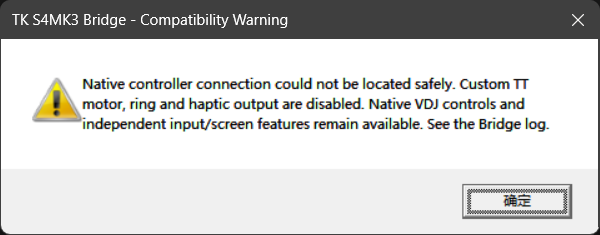
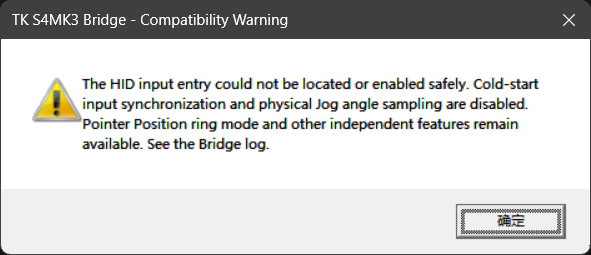
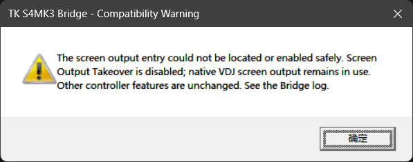
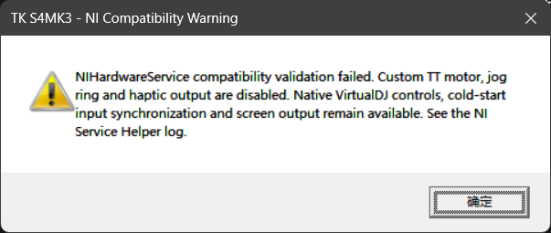

# FAQ ❓

[中文](FAQ_zh.md) · English

**1.** <b style="font-size: 1.15em">Q:</b> <b style="font-size: 1.15em">How does it work?</b>

&emsp;**A:** The project extends VirtualDJ’s official mapping. A DLL reads Deck state and publishes it to the paired EXE, which controls motors, rings and haptic feedback through NIHardwareService. VirtualDJ skins render screen content; screen takeover sends it asynchronously in the background. The project uses official NI drivers throughout; switching to WinUSB is not required.

**2.** <b style="font-size: 1.15em">Q:</b> <b style="font-size: 1.15em">Which versions are supported?</b>

&emsp;**A:** Windows x64 with VirtualDJ 2021 or later, a VirtualDJ Pro license, official NI drivers and NIHardwareService are required. The project was developed against VirtualDJ build 9005 and tested only with 9005 / 9644. Full functionality is not guaranteed with every version. See [Supported Versions](SUPPORTED_VERSIONS.md) for details.

**3.** <b style="font-size: 1.15em">Q:</b> <b style="font-size: 1.15em">Why are administrator privileges required?</b>

&emsp;**A:** The paired EXE needs elevated access to NIHardwareService and device objects to control motors, rings and haptic feedback. Allow the helper’s UAC prompt when it starts; VirtualDJ itself does not need to be configured to run as administrator.

**4.** <b style="font-size: 1.15em">Q:</b> <b style="font-size: 1.15em">Can I rename files or mix versions?</b>

&emsp;**A:** Do not rename the DLL/EXE or mix them across builds. The DLL binds the paired EXE’s filename and SHA-256. Even with the same version number, a rebuilt EXE must be paired with the DLL from that build. Update using matching files from the same release archive.

**5.** <b style="font-size: 1.15em">Q:</b> <b style="font-size: 1.15em">Can I alternate between VirtualDJ and Traktor?</b>

&emsp;**A:** Yes. The project uses NIHardwareService and official NI drivers. After closing VirtualDJ normally, you can launch and use Traktor Pro 3/4 directly without switching drivers or taking additional steps.

**6.** <b style="font-size: 1.15em">Q:</b> <b style="font-size: 1.15em">Do the installed components have an effect when I am not using the S4 MK3?</b>

&emsp;**A:** The DLL is in AutoStart, so it still loads with VirtualDJ, initializes, writes logs and waits for a device connection; it is not completely inactive. Without a validated native S4 MK3 connection, it does not launch the paired EXE or enter motor, ring or haptic control.

**7.** <b style="font-size: 1.15em">Q:</b> <b style="font-size: 1.15em">Why does a compatibility warning appear?</b>

&emsp;**A:** An internal location or object required by a feature failed validation, or its hook could not be enabled safely, so the affected feature is disabled. Changes in VirtualDJ or NIHardwareService versions can cause this; it does not mean every feature is unavailable. Match the warning below to identify the affected features.

**Controller connection could not be located**

The DLL could not safely locate VirtualDJ's native controller connection. Custom TT motor, ring and haptic output are disabled. Native VirtualDJ controls and independent input and screen features remain available. Log: `Traktor-Kontrol-S4-MK3-Bridge-v0.1.1.log`.

**HID input could not be located or hooked**

The HID input hook could not be located or enabled safely. Cold-start control-state synchronization and physical Jog angle sampling are disabled. Pointer Position ring mode and other independent features remain available. Log: `Traktor-Kontrol-S4-MK3-Bridge-v0.1.1.log`.

**Screen output could not be located or hooked**

The screen output hook could not be located or enabled safely. Screen Output Takeover is disabled, and native VirtualDJ screen output remains in use. Other controller features are unaffected by this warning. Log: `Traktor-Kontrol-S4-MK3-Bridge-v0.1.1.log`.

**NIHardwareService compatibility validation failed**

NIHardwareService's internal objects, functions or fields failed compatibility validation. Custom TT motor, ring and haptic output are disabled. Native VirtualDJ controls, cold-start synchronization and screen output remain available. Log: `Traktor-Kontrol-S4-MK3-NI-Service-Helper-v0.1.1.log`.

Logs are in `Plugins64\AutoStart` inside the VirtualDJ data folder. Please [submit an Issue](https://github.com/SmallM1NG/Traktor-Kontrol-S4-MK3-Support-for-VirtualDJ/issues) with the warning screenshot and the corresponding log.

**8.** <b style="font-size: 1.15em">Q:</b> <b style="font-size: 1.15em">Why does the helper EXE fail to start without showing a UAC prompt?</b>

&emsp;**A:** Windows may block the helper because it inherited an Internet security mark from the downloaded ZIP. Before extracting, right-click the ZIP, open **Properties**, and select **Unblock** on the General tab if the option is present, then click **Apply** and extract the archive. If you have already extracted it, close VirtualDJ, unblock the paired EXE through its Properties, then restart VirtualDJ.
