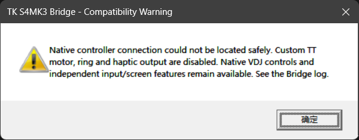
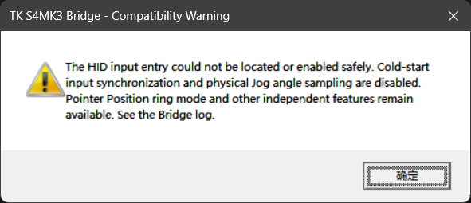
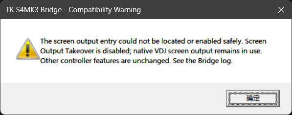
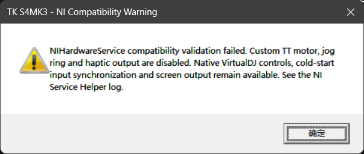

# FAQ ❓

中文 · [English](FAQ.md)

**1.** <b style="font-size: 1.15em">Q:</b> <b style="font-size: 1.15em">原理是什么？</b>

&emsp;**A:** 本项目在 VirtualDJ 官方映射的基础上，通过 DLL 读取软件中的 Deck 状态，并将数据传给配套 EXE，由 EXE 通过 NIHardwareService 控制电机、灯环和触觉反馈。屏幕内容由 VirtualDJ 皮肤绘制，开启屏幕输出接管后在后台异步发送。全程使用 NI 官方驱动，不需要替换为 WinUSB。

**2.** <b style="font-size: 1.15em">Q:</b> <b style="font-size: 1.15em">支持哪些版本？</b>

&emsp;**A:** 仅支持 Windows x64 的 VirtualDJ 2021 及以上版本，需拥有 VirtualDJ Pro 许可证，并安装 NI 官方驱动及 NIHardwareService。本项目基于 VirtualDJ 9005 开发，仅在 9005 / 9644 下测试过，不保证全部功能在任意版本中都能正常使用。具体请查看[支持版本](SUPPORTED_VERSIONS_zh.md)。

**3.** <b style="font-size: 1.15em">Q:</b> <b style="font-size: 1.15em">为什么需要管理员权限？</b>

&emsp;**A:** 配套 EXE 需要访问 NIHardwareService 进程及设备对象，执行电机、灯环和触觉控制，因此需要管理员权限。启动时允许配套助手的 UAC 提权即可，无需将 VirtualDJ 本身设置为以管理员身份运行。

**4.** <b style="font-size: 1.15em">Q:</b> <b style="font-size: 1.15em">能不能改名或混用版本？</b>

&emsp;**A:** 不能修改 DLL / EXE 的文件名，也不能混用不同次构建的 DLL 和 EXE。DLL 绑定了配套 EXE 的文件名与 SHA-256，即使版本号相同，重新编译的 EXE 也必须搭配同次生成的 DLL。更新时使用同一发行包内的配套文件。

**5.** <b style="font-size: 1.15em">Q:</b> <b style="font-size: 1.15em">能不能与 Traktor 交替使用？</b>

&emsp;**A:** 可以。本项目使用 NIHardwareService 和 NI 官方驱动，正常关闭 VirtualDJ 后，可直接启动 Traktor Pro 3/4 并正常使用，无需更换驱动或执行额外操作。

**6.** <b style="font-size: 1.15em">Q:</b> <b style="font-size: 1.15em">不使用 S4 MK3 时，安装的组件会有影响吗？</b>

&emsp;**A:** DLL 位于 AutoStart，因此启动 VirtualDJ 时仍会加载，进行初始化、写入日志并等待设备连接；它并非完全不运行。未检测到有效的 S4 MK3 原生连接时，不会启动配套 EXE，也不会进入设备电机、灯环和触觉控制。

**7.** <b style="font-size: 1.15em">Q:</b> <b style="font-size: 1.15em">弹出兼容性警告？</b>

&emsp;**A:** 对应功能所需的内部位置或对象未通过校验，或挂接未能安全启用，相关功能会停用。VirtualDJ 或 NIHardwareService 的版本变化可能导致这种情况，并不代表全部功能都不可用。可按下图确认受影响的功能。

**控制器连接定位失败**

无法安全定位 VirtualDJ 的原生控制器连接，本项目的 TT 电机、灯环与触觉输出停用。VirtualDJ 原生控制及独立的输入、屏幕功能仍可使用。对应日志：`Traktor-Kontrol-S4-MK3-Bridge-v0.1.1.log`。

**HID 输入定位或挂接失败**

无法安全定位或启用 HID 输入挂接，启动时的控件初始状态同步与实体 Jog 角度采样停用。Pointer Position 灯环模式及其他独立功能仍可使用。对应日志：`Traktor-Kontrol-S4-MK3-Bridge-v0.1.1.log`。

**屏幕输出定位或挂接失败**

无法安全定位或启用屏幕输出挂接，Screen Output Takeover 停用，继续使用 VirtualDJ 原生屏幕输出；其他控制器功能不受此报错影响。对应日志：`Traktor-Kontrol-S4-MK3-Bridge-v0.1.1.log`。

**NIHardwareService 兼容性校验失败**

NIHardwareService 的内部对象、函数或字段未通过兼容性校验，本项目的 TT 电机、灯环与触觉输出停用。VirtualDJ 原生控制、启动初始状态同步及屏幕输出仍可使用。对应日志：`Traktor-Kontrol-S4-MK3-NI-Service-Helper-v0.1.1.log`。

日志位于 VirtualDJ 数据目录的 `Plugins64\AutoStart`。反馈时请附上报错截图及对应日志，并[提交 Issue](https://github.com/SmallM1NG/Traktor-Kontrol-S4-MK3-Support-for-VirtualDJ/issues)。

**8.** <b style="font-size: 1.15em">Q:</b> <b style="font-size: 1.15em">配套 EXE 无法启动，而且没有出现 UAC 提示？</b>

&emsp;**A:** EXE 可能继承了下载 ZIP 的互联网安全标记，导致 Windows 阻止启动。解压前，右键 ZIP 打开**属性**，如果“常规”页有**解除锁定**选项，请勾选并点击**应用**后再解压。如果已经解压，请先关闭 VirtualDJ，在配套 EXE 的属性中解除锁定，再重新启动 VirtualDJ。
