<p align="center">
  
</p>

<p align="center"><b>Traktor Kontrol S4 MK3 Support for VirtualDJ</b></p>
<p align="center">
	<a href="https://github.com/SmallM1NG/Traktor-Kontrol-S4-MK3-Support-for-VirtualDJ/releases/latest"></a>
	
	
	
	
	<a href="https://github.com/SmallM1NG/Traktor-Kontrol-S4-MK3-Support-for-VirtualDJ/stargazers"></a>
</p>

<p align="center"><b>English</b> · <a href="README_zh.md">中文</a></p>

<p align="center"><a href="#project-introduction">Project Introduction</a> · <a href="#feature-showcase">Feature Showcase</a> · <a href="#how-to-install">How to Install</a> · <a href="#how-to-use">How to Use</a> · <a href="#additional-information">Additional Information</a></p>

<p align="center"><a href="Docs/md/FAQ.md">FAQ</a> · <a href="Docs/md/DEVELOPMENT.md">Development</a> · <a href="Docs/md/CHANGELOG.md">Changelog</a></p>

---

<a id="project-introduction"></a>
## Project Introduction ℹ️

This project provides **almost complete** support for the **Native Instruments Traktor Kontrol S4 MK3** in **VirtualDJ**.

- Based on VirtualDJ's official mapping, it adds automatic fader position reporting at startup, along with screen, motor and lighting features.
- The left and right screens work independently, with **12 pages** available to switch between at any time.
- Supports **motor-related features (TT Mode)**, with settings for **rotation speed, haptic ticks, tension, Hotcue haptic feedback** and more.
- Supports switching between **17 Deck colors**.

> This project is open source under [GPLv3](LICENSE). Please comply with this license when using, modifying or distributing it.

> [!WARNING]
> This project is independently maintained by an enthusiast and is not affiliated with VirtualDJ or Native Instruments.  
> This project only supports <strong>Windows x64</strong>, was developed against **VirtualDJ build 9005**, and has only been tested with builds **9005 / 9644**. Not all features are guaranteed to work correctly with every version.  
> Some features are experimental and have not undergone long-term testing. Stability issues may occur; you assume responsibility for any resulting losses.

<a id="feature-showcase"></a>
## Feature Showcase ✨

### Hardware Demo

<p align="center">
  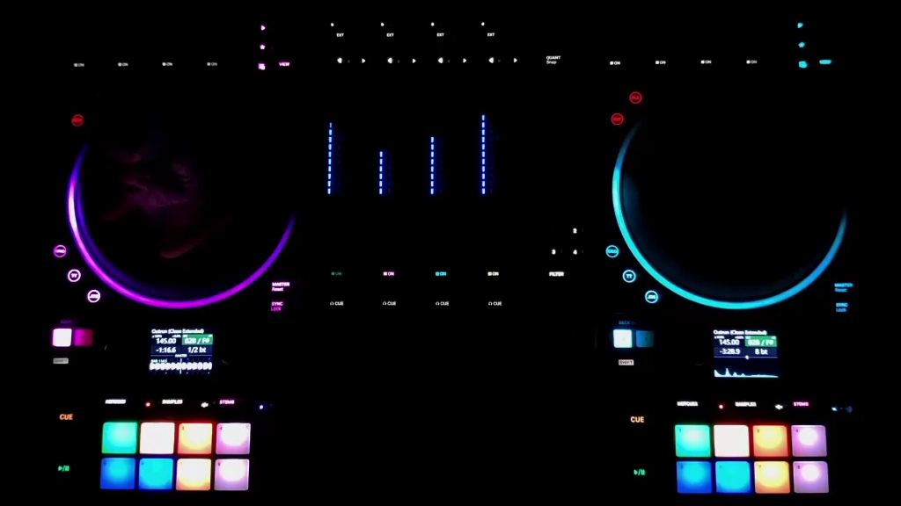
</p>

### Screen Styles

<table align="center">
  <tr>
    <td align="center">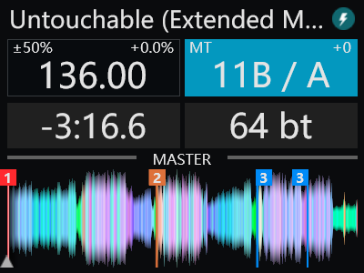<br><b>Overview</b></td>
    <td align="center">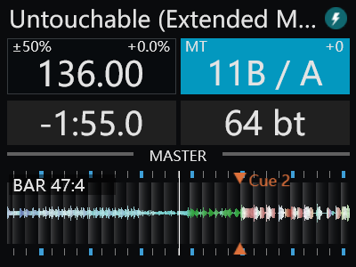<br><b>Live Waveform</b></td>
    <td align="center">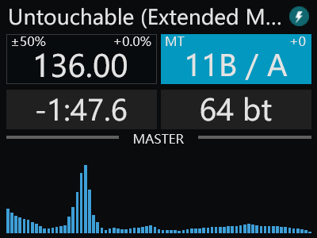<br><b>Spectrum</b></td>
    <td align="center">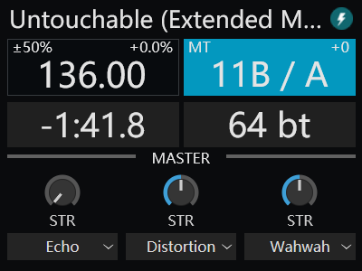<br><b>Effects</b></td>
  </tr>
  <tr>
    <td align="center">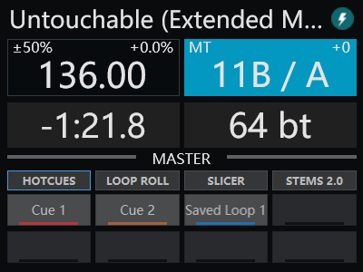<br><b>PAD</b></td>
    <td align="center">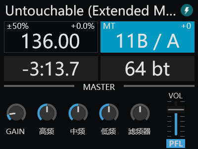<br><b>Mixer</b></td>
    <td align="center">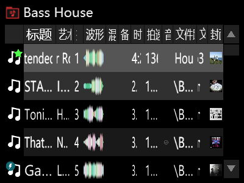<br><b>Native Browser</b></td>
    <td align="center">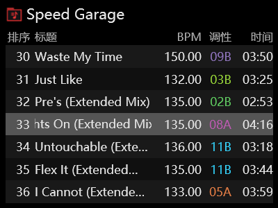<br><b>Custom Browser</b></td>
  </tr>
  <tr>
    <td align="center">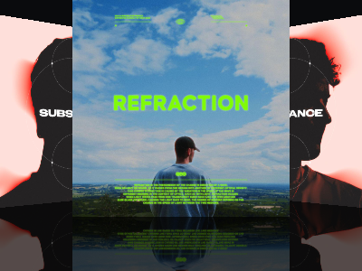<br><b>3D Browser</b></td>
    <td align="center">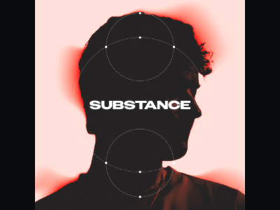<br><b>Track Cover</b></td>
    <td align="center"><br><b>Logo</b></td>
    <td align="center">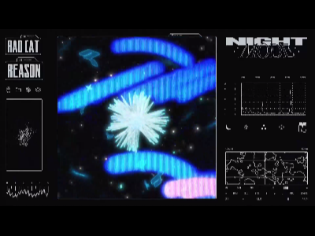<br><b>Video</b></td>
  </tr>
</table>

### Deck Color Palette

<table align="center">
  <tr>
    <td align="center" width="64"></td>
    <td align="center" width="64"></td>
    <td align="center" width="64"></td>
    <td align="center" width="64"></td>
    <td align="center" width="64"></td>
    <td align="center" width="64"></td>
    <td align="center" width="64"></td>
    <td align="center" width="64"></td>
    <td align="center" width="64"></td>
    <td align="center" width="64"></td>
  </tr>
  <tr>
    <td align="center" width="64"></td>
    <td align="center" width="64"></td>
    <td align="center" width="64"></td>
    <td align="center" width="64"></td>
    <td align="center" width="64"></td>
    <td align="center" width="64"></td>
    <td align="center" width="64"></td>
    <td align="center" width="64"></td>
    <td align="center" width="64"></td>
    <td align="center" width="64"></td>
  </tr>
  <tr>
    <td align="center" width="64">Red</td>
    <td align="center" width="64">Carrot</td>
    <td align="center" width="64">Orange</td>
    <td align="center" width="64">Beige</td>
    <td align="center" width="64">Yellow</td>
    <td align="center" width="64">Lime</td>
    <td align="center" width="64">Green</td>
    <td align="center" width="64">Aqua</td>
    <td align="center" width="64">Cyan</td>
    <td align="center" width="64">Marine</td>
  </tr>
</table>

<table align="center">
  <tr>
    <td align="center" width="64"></td>
    <td align="center" width="64"></td>
    <td align="center" width="64"></td>
    <td align="center" width="64"></td>
    <td align="center" width="64"></td>
    <td align="center" width="64"></td>
    <td align="center" width="64"></td>
  </tr>
  <tr>
    <td align="center" width="64"></td>
    <td align="center" width="64"></td>
    <td align="center" width="64"></td>
    <td align="center" width="64"></td>
    <td align="center" width="64"></td>
    <td align="center" width="64"></td>
    <td align="center" width="64"></td>
  </tr>
  <tr>
    <td align="center" width="64">Blue</td>
    <td align="center" width="64">Violet</td>
    <td align="center" width="64">Fuscia</td>
    <td align="center" width="64">Magenta</td>
    <td align="center" width="64">Pink</td>
    <td align="center" width="64">Salmon</td>
    <td align="center" width="64">White</td>
  </tr>
</table>


---

<a id="how-to-install"></a>
## How to Install 📥

This project only supports **VirtualDJ 2021 or later** on **Windows x64**, requires a **VirtualDJ Pro** license, and depends on **NIHardwareService**. Make sure you meet these requirements.

> [!WARNING]
> **Attention:** If you have used a similar project and replaced the screen driver with **WinUSB (communicating with the screens through USB Bulk)**, restore the official NI screen driver, **niks4m3bd**, before using this project. If you replaced drivers for other modules, restore those as well.  
> This project's features rely on **NIHardwareService** and the official NI drivers. You can therefore close VirtualDJ, launch Traktor Pro 3/4 directly and use it normally without any additional steps.  

<ol>
<li>

<p><strong>First, make sure NIHardwareService is installed on your system.</strong> It is usually installed alongside Traktor Pro or Controller Editor.</p>
<p><strong>How to check:</strong> Press <code>Win + R</code>, enter <code>services.msc</code> and press Enter. Look for <strong>NIHardwareService</strong> in the Services list.</p>
<ul>
  <li><strong>Found:</strong> Confirm that its status is “Running”, then continue to the next step. If it is not running, right-click it, select “Start” and check again.</li>
  <li><strong>Not found:</strong> Install either of the following:
    <ul>
      <li><a href="https://www.native-instruments.com/zh/products/traktor-pro">Traktor Pro</a></li>
      <li><a href="https://support.native-instruments.com/support/solutions/articles/69000882238-native-instruments-drivers-other-files#Controller-Editor">Controller Editor for Windows</a></li>
    </ul>
    After installation, reopen Services and check for NIHardwareService again. Continue only after confirming that it is present and running.
  </li>
</ul>

</li>

<li>

Download the latest **ZIP archive** from [Releases](https://github.com/SmallM1NG/Traktor-Kontrol-S4-MK3-Support-for-VirtualDJ/releases/latest) (currently [v0.1.0](https://github.com/SmallM1NG/Traktor-Kontrol-S4-MK3-Support-for-VirtualDJ/releases/tag/v0.1.0)).

</li>
<li>

Before extracting, right-click the downloaded ZIP archive and select <strong>Properties</strong>. If an <strong>Unblock</strong> checkbox appears at the bottom of the General tab, select it and click <strong>Apply</strong> before extracting. If it is not present, extract normally. This prevents the downloaded-file security mark from blocking the helper EXE's elevation request without showing a UAC prompt.

If you have already extracted the archive and the helper EXE will not start, close VirtualDJ, open the EXE's <strong>Properties</strong> and unblock it in the same way, then restart VirtualDJ.

<strong>Extract all contents</strong> of the archive. It should contain the following files:

```text
Traktor Kontrol S4 MK3 Bridge v0.1.0.dll
Traktor Kontrol S4 MK3 NI Service Helper v0.1.0.exe
Traktor Kontrol S4 MK3 Screen Preview (Default).zip
Traktor Kontrol S4 MK3 Screen.zip
Traktor Kontrol S4 MK3.zip
S4MK3 Settings.xml
```

</li>
<li>

<strong>Locate your VirtualDJ data folder</strong>:

- Versions before 2023 usually use `C:\Users\Username\Documents\VirtualDJ`.
- Versions after 2023 usually use `C:\Users\Username\AppData\Local\VirtualDJ`.
- If you changed the data folder, confirm the location of your custom folder.

</li>
<li>

<strong>Close VirtualDJ</strong>, then copy the files into the corresponding folders inside your data folder:

| File | Destination (relative to the VirtualDJ data folder) | Notes |
| --- | --- | --- |
| `Traktor Kontrol S4 MK3 Bridge v0.1.0.dll` | `Plugins64\AutoStart` | <strong>Keep alongside the matching EXE</strong> |
| `Traktor Kontrol S4 MK3 NI Service Helper v0.1.0.exe` | `Plugins64\AutoStart` | <strong>Keep alongside the matching DLL</strong> |
| `Traktor Kontrol S4 MK3.zip` | `Devices` | <strong>Do not extract</strong> |
| `Traktor Kontrol S4 MK3 Screen.zip` | `Skins` | <strong>Do not extract</strong> |
| `Traktor Kontrol S4 MK3 Screen Preview (Default).zip` | `Skins` | <strong>Do not extract</strong> |
| `S4MK3 Settings.xml` | `Pads` | Copy directly |

</li>
<li>

Launch VirtualDJ. If **Traktor Kontrol S4 MK3 Bridge v0.1.0** appears in the Master effects list, installation is complete.

</li>
</ol>

---

<a id="how-to-use"></a>
## How to Use ▶️

### 1. Connect the Device and Start VirtualDJ

Power on the S4 MK3 and connect it to your computer, then open VirtualDJ. Once VirtualDJ connects to the S4 MK3, the DLL <strong>automatically starts the paired EXE</strong>. If a UAC prompt appears, click <strong>“Yes”</strong> to enable all project features. You can then adjust some features using the supplied PAD mapping or the controller settings in VirtualDJ.

> [!WARNING]
> The paired EXE needs <strong>administrator privileges</strong> to access the **NIHardwareService process and device objects** for motor, ring and haptic control. If elevation is denied, these EXE-dependent features will not work correctly. <strong>VirtualDJ itself does not need to run as administrator.</strong>  
> A <strong>“feature unavailable”</strong> dialog means that an internal location or device object required by the affected feature failed validation. <strong>That feature is disabled</strong>; this does not mean all features are unavailable. Check the dialog to identify the affected feature and submit an Issue.

### 2. Settings Adjusted from the PAD Page

> Except for <strong>preview window visibility and combined / separate mode</strong>, all PAD settings are <strong>saved independently for each Deck</strong>.

#### Open the Settings Page

Select **S4MK3 Settings** as the PAD page in VirtualDJ. Use **Param 1** to cycle through three settings pages:

| Page | Purpose |
| --- | --- |
| `TT/COLOR` | Toggle TT mode and adjust Deck colors |
| `Screen Style` | Adjust time display, waveform and spectrum appearance, and played-section color shading |
| `Screen Switch` | Change screen pages and configure AUTO and preview windows |

#### TT Mode and Deck Colors

<p>On the <strong>TT/COLOR</strong> page:</p>

<p align="left">
  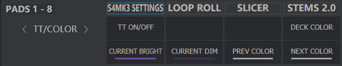
</p>
<table>
<thead><tr><th>Control</th><th>Function</th></tr></thead>
<tbody>
<tr><td><code>TT ON/OFF</code></td><td>Toggle TT mode for the current Deck</td></tr>
<tr><td><code>DECK COLOR</code></td><td>Apply the current Deck color to the corresponding device Deck. Recognizes the 17 supported colors and their aliases; other colors preserve the existing bright/dim pair</td></tr>
<tr><td><code>PREV COLOR</code> / <code>NEXT COLOR</code></td><td>Cycle through 17 colors</td></tr>
<tr><td><code>CURRENT BRIGHT</code> / <code>CURRENT DIM</code></td><td>Display the current bright and dim colors</td></tr>
</tbody>
</table>

#### Screen Style

<p>On the <strong>Screen Style</strong> page:</p>

<p align="left">
  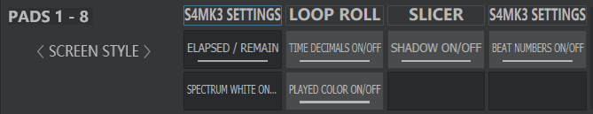
</p>
<table>
<thead><tr><th>Control</th><th>Function</th></tr></thead>
<tbody>
<tr><td><code>ELAPSED / REMAIN</code></td><td>Switch between elapsed and remaining time</td></tr>
<tr><td><code>TIME DECIMALS ON/OFF</code></td><td>Show / hide time decimals</td></tr>
<tr><td><code>SHADOW ON/OFF</code></td><td>Show / hide the live waveform beat background shading</td></tr>
<tr><td><code>BEAT NUMBERS ON/OFF</code></td><td>Show / hide live waveform beat numbers</td></tr>
<tr><td><code>SPECTRUM WHITE ON/OFF</code></td><td>Toggle the white spectrum display</td></tr>
<tr><td><code>PLAYED COLOR ON/OFF</code></td><td>Toggle Deck-colored shading over the played overview waveform; retain native darkening when off</td></tr>
</tbody>
</table>

#### Screen Pages and Previews

<p>On the <strong>Screen Switch</strong> page:</p>

<p align="left">
  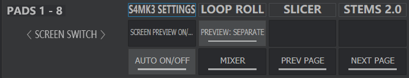
</p>
<table>
<thead><tr><th>Control</th><th>Function</th></tr></thead>
<tbody>
<tr><td><code>SCREEN PREVIEW ON/OFF</code></td><td>Show / hide screen preview windows</td></tr>
<tr><td><code>PREVIEW: COMBINED / SEPARATE</code></td><td>Switch between combined and separate preview windows</td></tr>
<tr><td><code>AUTO ON/OFF</code></td><td>Toggle automatic page switching while browsing</td></tr>
<tr><td>Current page name</td><td>Display the selected screen page</td></tr>
<tr><td><code>PREV PAGE</code> / <code>NEXT PAGE</code></td><td>Select the previous / next page for the current Deck</td></tr>
</tbody>
</table>

<p>You can also use these controller shortcuts to change pages:</p>
<table>
<thead><tr><th>Action</th><th>Function</th></tr></thead>
<tbody>
<tr><td>SHIFT + A / C</td><td>Previous / next page on the left screen</td></tr>
<tr><td>SHIFT + B / D</td><td>Previous / next page on the right screen</td></tr>
</tbody>
</table>

<p><strong>AUTO:</strong> Enable <code>AUTO ON/OFF</code> on Screen Switch. Using the corresponding controller browse knob opens the last browser page; loading or cloning a track from the controller restores the last non-browser page. Mouse and keyboard actions do not trigger this automatic page switching.</p>
<p><strong>Preview windows:</strong> Select the <strong>Traktor Kontrol S4 MK3 Screen Preview (Default)</strong> skin, then use <code>SCREEN PREVIEW ON/OFF</code> on Screen Switch to show or hide previews. Use <code>PREVIEW: COMBINED / SEPARATE</code> to choose combined or separate windows. Windows are resizable; scaled previews are not guaranteed to match hardware screens pixel for pixel.</p>

<table align="center">
<tr><th align="center"><p align="center">1</p></th><th align="center"><p align="center">2</p></th><th align="center"><p align="center">3</p></th><th align="center"><p align="center">4</p></th><th align="center"><p align="center">5</p></th><th align="center"><p align="center">6</p></th><th align="center"><p align="center">7</p></th><th align="center"><p align="center">8</p></th><th align="center"><p align="center">9</p></th><th align="center"><p align="center">10</p></th><th align="center"><p align="center">11</p></th><th align="center"><p align="center">12</p></th></tr>
<tr><td align="center"><p align="center">Overview</p></td><td align="center"><p align="center">Live Waveform</p></td><td align="center"><p align="center">Spectrum</p></td><td align="center"><p align="center">Effects</p></td><td align="center"><p align="center">PAD</p></td><td align="center"><p align="center">Mixer</p></td><td align="center"><p align="center">Native Browser</p></td><td align="center"><p align="center">Custom Browser</p></td><td align="center"><p align="center">3D Browser</p></td><td align="center"><p align="center">Track Cover</p></td><td align="center"><p align="center">Logo</p></td><td align="center"><p align="center">Video</p></td></tr>
</table>

### 3. Settings Adjusted from the Software Controller Settings Page

<ol>
<li>Open VirtualDJ <strong>Settings → Controllers</strong>.</li>
<li>Select <strong>Traktor Kontrol S4 MK3</strong> and click the device's <strong>gear icon</strong> to open its specific settings.</li>
<li>Find the corresponding option below, then select a mode or change its value (these options have the same functions as the settings with the same names in Traktor Pro 3/4).</li>
</ol>

<p align="center">
  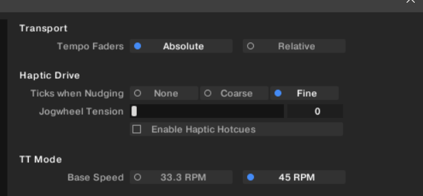
  <br><b>Traktor Pro 3/4 Settings</b>
</p>

<p align="center">
  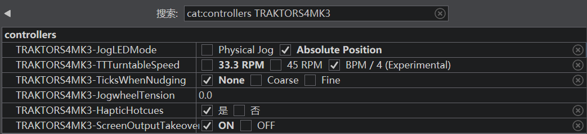
  <br><b>VirtualDJ Controller Settings</b>
</p>
<table>
<thead><tr><th>Setting Name</th><th>Description</th></tr></thead>
<tbody>
<tr><td><code>JogLEDMode</code></td><td>Set the Jog ring pointer mode. <strong>Physical Jog</strong> adds manual movement to playback rotation, follows only manual movement when touched or paused, and follows the physical platter directly in TT mode. <strong>Absolute Position</strong> fully follows the pointer position in the software.</td></tr>
<tr><td><code>TTTurntableSpeed</code></td><td>Set the platter rotation speed. Selecting <strong>33.3 / 45 RPM</strong> uses the corresponding base speed and adjusts it according to the Tempo fader position; <strong>BPM / 4 (Experimental)</strong> calculates the speed as the current BPM divided by four. The maximum is <strong>75 RPM</strong>; exceeding it stops the motor. Rotation resumes when the speed returns within range, TT is enabled and the track is playing.</td></tr>
<tr><td><code>TicksWhenNudging</code></td><td>Set the haptic ticks during playback in Jog mode. Select <strong>None</strong> to disable them, <strong>Coarse</strong> for coarse ticks, or <strong>Fine</strong> for fine ticks. Applies to both Jog wheels.</td></tr>
<tr><td><code>JogwheelTension</code></td><td>Set the rotation resistance for both Jog wheels by entering an integer from <strong>0 to 255</strong>. Higher values increase resistance; 0 is the lightest.</td></tr>
<tr><td><code>HapticHotcues</code></td><td>Set whether Cue point haptic feedback is enabled: select <strong>yes</strong> to enable it or <strong>no</strong> to disable it. Feedback is provided at the main Cue, <strong>Hotcue points 1–8</strong> and the start/end points of <strong>Saved Loops 1–8</strong>.</td></tr>
<tr><td><code>Screen Output Takeover</code></td><td>Set the output method for the device screens. When <strong>ON</strong>, a <strong>background thread in the DLL</strong> sends screen frames without affecting skin rendering in the main software interface, significantly reducing stutter in the main interface. When <strong>OFF</strong>, native VirtualDJ output is restored. This setting applies to both screens.</td></tr>
</tbody>
</table>

---

<a id="additional-information"></a>
## Additional Information 📚

<p align="center"><a href="Docs/md/DEVELOPMENT.md">Development</a> · <a href="Docs/md/FAQ.md">FAQ</a></p>

### Additional Notes 💡

> [!WARNING]
> **Known Issues**
>
> 1. **Jog rim nudging in TT mode:** With TT enabled, touching the side of the platter cannot temporarily speed up or slow down playback. I tried several approaches, but each had stability issues. With limited energy left to keep trying, I have put this aside for now.
> 2. **HapticHotcues point detection:** Only Hotcue / Saved Loop points numbered 1–8 are supported; marker-only or hidden points are not supported. A Hotcue set while a Loop is active behaves like a Saved Loop, but its Loop length cannot be read correctly. Restart VirtualDJ and let it automatically become a Saved Loop before its length can be read correctly.
> 3. **Motor speed limit:** The motor speed limit is <strong>75 RPM (300 BPM ÷ 4)</strong> and applies to all speed modes. This limit is imposed because it is unclear whether higher speeds could damage the motor. If the speed about to be sent to the motor exceeds the limit, it is rejected and the motor stops immediately. Once the speed returns within the limit, rotation resumes automatically while TT mode is enabled and the track is playing.


---

<a id="bug-reports"></a>
### Bug Reports 😨

Check the [FAQ](Docs/md/FAQ.md) and Known Issues above first. If the problem remains, report it through [Issues](https://github.com/SmallM1NG/Traktor-Kontrol-S4-MK3-Support-for-VirtualDJ/issues) and include:

- **Versions:** Project, VirtualDJ, Windows and NIHardwareService versions.
- **Problem details:** Describe what happened, whether it can be reproduced, the steps to reproduce it, and include relevant screenshots or other supporting information.
- **Runtime logs:** Attach the DLL/EXE logs from `Plugins64\AutoStart` in your VirtualDJ data folder and note when the problem occurred.

---

<a id="acknowledgements"></a>
### Acknowledgements 🙌

Thanks to [MIXXX](https://github.com/mixxxdj/mixxx) and [Encdr](https://github.com/RufusIbiza/Encdr) for providing some of the references used to develop this project.  
Thanks to everyone who helped test this project.

---

<a id="links"></a>
### LINK 🔗

<p align="center">
  <a href="https://space.bilibili.com/475951038">BILIBILI</a>
  ·
  <a href="https://www.virtualdj.com/wiki/Developers.html">VirtualDJ Developer Documentation</a>
</p>

---

<a id="donate"></a>
### Donate 🧋

<p align="center">
  🥰Treat me to bubble tea, meow! Thank you, meow!🥰
</p>

<p align="center">
  <a href="https://ko-fi.com/djm1ng"></a>
</p>

<p align="center">
  
</p>
